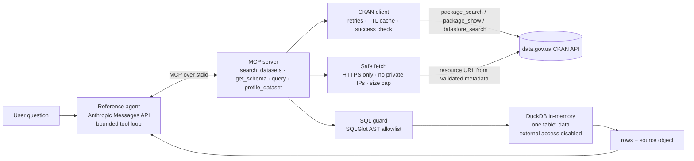

# Open Data MCP

An MCP server and a small reference agent that answer questions about **Ukrainian open data**
(CKAN portal [data.gov.ua](https://data.gov.ua)) from *retrieved data and deterministic SQL*, not
from model memory. Every successful data-backed answer carries machine-readable provenance.

> **Status: working prototype, not production software.** The CKAN adapter, SQL safety layer, MCP
> server, agent and evaluation are implemented and tested **offline against a mocked portal,
> SYNTHETIC fixtures and one committed real `data.gov.ua` snapshot** (CC BY). A live smoke test
> against `data.gov.ua` passed on 2026-10-18 (CSV path only; see
> [Verification status](#verification-status) for exactly what was and was not exercised).

## The problem

Asking an LLM "how many … were registered in region X in 2023?" invites a confident, unsourced,
possibly invented number. Open-data portals publish the real figures, but finding the right
resource, understanding its columns and computing an aggregate is tedious. This project lets a
model do exactly that **through tools**, with a hard boundary: numbers come from a SQL query over
the real resource, and the answer shows where the data came from and when it was fetched.

## What you can ask

Questions whose answer is a computation over one tabular resource, in Ukrainian or English:

- *"Скільки звернень у Центральному районі?"* → `COUNT` with a filter
- *"Total planned budget for 2024 across regions?"* → `SUM` over a DataStore resource
- *"Which region executed the most in 2023?"* → `GROUP BY … ORDER BY`
- *"Find datasets about air quality"* → dataset search

It should **refuse or abstain** when the data cannot answer (forecasts, opinions, unsupported
formats, oversized files, columns that do not exist).

## Architecture



Source layout (`src/open_data_mcp/`): `ckan_client.py`, `safe_fetch.py`, `query_engine.py`,
`provenance.py`, `service.py` (pure-Python logic), `server.py` (MCP), `agent.py`, `cli.py`,
`profiling.py` / `profile_issues.py` / `encoding_check.py` / `drift.py` (data-quality profile),
`fakeportal.py` + `messy_fixture.py` (synthetic fixtures for offline use).

## Why MCP, and the four tools

MCP keeps the data layer independent from any one model or UI: the same server works with the
bundled agent, Claude Desktop/Code, or any MCP client. All tools are read-only and publish JSON
input *and* output schemas.

| Tool | Purpose |
|---|---|
| `search_datasets(query, limit)` | Dataset ID, title, short description, organization, license, URL, resource formats. `limit` is clamped to 20. |
| `get_schema(dataset_id, resource_id?)` | Columns/types and **how they were obtained**: `datastore_metadata` (authoritative) or `inferred_from_file` (a guess, flagged `authoritative: false`). Without `resource_id` it lists the dataset's resources and which are queryable. |
| `query(dataset_id, resource_id, sql, limit?)` | One read-only `SELECT` over a single resource, exposed as table `data`. Returns columns, rows, `truncated`, `row_limit`, `rows_in_resource` and `source`. |
| `profile_dataset(dataset_id, resource_id?, compare_versions?)` | A data-quality passport of one resource: ranked `issues` plus per-column missing share, duplicates, outliers, broken dates, text damage, encoding and schema drift. See below. |

Every tool returns an envelope with `ok`. On failure: `ok: false`, an `error` object with a stable
`code` (`unsafe_sql`, `unsafe_url`, `unsupported_resource`, `resource_too_large`, `sql_error`,
`not_found`, `upstream_error`, …) and a `hint`; **no rows, no numbers**.

## Data-quality profile (`profile_dataset`)

Open registries are often published with broken dates, mixed encodings and a schema that changes
from file to file. `profile_dataset` gives an analyst a quick "quality passport" before the data
is used. It returns ranked `issues` (worst first, each naming a column and quoting numbers) and
the supporting detail:

| Check | What is measured |
|---|---|
| Missing values | Per column: empty cells **and** placeholders such as `null`, `-`, `н/д`, `немає` (counted separately, with the values found). |
| Duplicates | Exact duplicate rows (beyond the first copy), repeated values in identifier-like columns, and rows that are at least 80% empty. |
| Outliers | Numeric columns (comma decimals and space/NBSP thousands are understood; codes with leading zeros are not numbers): Tukey fences at 1.5 and 3 x IQR. Identifier-like columns are skipped. |
| Dates | Impossible dates (`31.02.2023`), text that is not a date (`Петиція подано: 06.09.2016`), two-digit years, years outside 1900-2100, `1900-01-01` / `1970-01-01` stand-ins, and mixed layouts in one column. Day-first order is assumed. |
| Text and encoding | File encoding **line by line** (UTF-8, Windows-1251, or both mixed), BOM, mojibake (UTF-8 read as Windows-1251/1252), U+FFFD, control characters, padded values, CSV lines that do not fit the table. |
| Schema drift | Header and inferred column types compared with up to 6 sibling **CSV** resources of the dataset (one file per quarter, say): added, removed, renamed (case/spacing or similar name), reordered columns and type changes. The portal API does not expose earlier contents of a replaced file, so only sibling resources can be compared; non-CSV siblings are listed as skipped. |

**Coverage is explicit.** Unlike `query`, which refuses anything it cannot read whole, a file over
the size or row limit is profiled on its **first rows in file order** and the response says so
(`coverage.complete: false`, `rows_in_resource: null`, a `partial_coverage` issue, and the
citation). That is a prefix, not a random sample: a file sorted by date describes its oldest rows.
`query` still refuses such a file.

Outliers and severity thresholds are judgement calls, not facts about the data; they are
published in the response's `method_note`. Run it against the live portal with
`uv run python scripts/profile_live.py DATASET_ID [RESOURCE_ID]`.

## Provenance

`build_source()` is the only way a `source` object is made, and `assert_provenance()` refuses to
return a query result without `portal`, `dataset_id`, `resource_id` and `retrieved_at_utc`.

```jsonc
"source": {
  "portal": "...", "dataset_id": "...", "dataset_title": "...", "dataset_url": "...",
  "resource_id": "...", "resource_name": "...", "resource_url": "...",
  "retrieved_at_utc": "2026-10-18T20:20:04Z",   // when THIS SERVER fetched the data
  "metadata_retrieved_at_utc": "...",           // metadata may be older (TTL cache)
  "dataset_modified_at": null,                  // the portal's own date; null if not supplied
  "resource_modified_at": null, "license": null, "access_method": "file_download"
}
```

`retrieved_at_utc` is never used as a stand-in for the portal's publication/modification date;
unknown dates stay `null`. The tool also returns a one-line `citation`, and the reference agent
appends any citation the model forgot to include, so the source always reaches the user.

## How read-only SQL is constrained

1. **AST allowlist (SQLGlot, DuckDB dialect):** exactly one statement; root must be
   `SELECT`/`UNION`/`EXCEPT`/`INTERSECT` (CTEs allowed). Every table reference must be `data` or
   a CTE defined in the query: no file paths, URLs, `schema.table`, or table functions
   (`read_csv`, `glob`, `range`, …). Functions must be typed SQLGlot functions or on a small
   allowlist; `getenv`, `read_text`, `current_setting`, … are rejected. Parameters are rejected.
2. **Regenerated SQL:** the statement DuckDB runs is rendered from the validated AST, with a
   server-side `LIMIT` (default 20, hard max 100).
3. **Engine lockdown:** data is loaded into an in-memory table *first*; then
   `enable_external_access=false`, extension auto-loading off and `lock_configuration=true`.
   Tests confirm that even raw `read_csv('/etc/passwd')`, `COPY … TO`, `INSTALL` and `SET` fail
   at the DuckDB level.
4. **Resource limits:** 25 MB download cap, 500 000 row cap (refused, never silently truncated, so
   an aggregate always covers the entire resource), 20 s query timeout, 512 MB memory limit.
5. **No LLM-supplied URLs:** the model passes `dataset_id` + `resource_id`; the URL comes from
   CKAN metadata, must be `https://` on port 443, must resolve only to public addresses, and
   every redirect hop is re-validated.

Supported formats: CKAN DataStore, CSV (UTF-8 or Windows-1251, any delimiter DuckDB sniffs) and
JSON (array of flat records). XLS/XLSX, PDF, archives and other binaries are refused with
`unsupported_resource`.

## Setup

Requires Python ≥ 3.11 (developed and tested on 3.13.16; the suite also passes on 3.11.17) and
[`uv`](https://docs.astral.sh/uv/).

```bash
git clone https://github.com/AnatoliiBalakiriev/Open-Data-MCP && cd Open-Data-MCP
uv sync --locked
```

### Run the MCP server

```bash
uv run open-data-mcp serve                      # live portal (default https://data.gov.ua)
uv run open-data-mcp serve --offline-fixtures   # SYNTHETIC data, no network
uv run open-data-mcp serve --offline-snapshot   # replay of one real data.gov.ua resource, no network
```

Connect an MCP client (stdio). Example for Claude Code / Claude Desktop style config:

```json
{
  "mcpServers": {
    "open-data": {
      "command": "uv",
      "args": ["run", "--directory", "/path/to/Open-Data-MCP", "open-data-mcp", "serve"]
    }
  }
}
```

*(The stdio protocol path is covered by an automated test with the official MCP client; the
config above has not been tried in Claude Desktop itself.)*

### Ask a question through the reference agent

```bash
cp .env.example .env        # then put ANTHROPIC_API_KEY in .env
uv run open-data-mcp ask "Скільки звернень у Центральному районі?" --offline-fixtures
uv run open-data-mcp ask "Find datasets about air quality"       # live portal
```

The agent uses the Anthropic Messages API (`ANTHROPIC_MODEL`, default `claude-sonnet-5-5`, checked
against the official models overview page on 2026-10-18), connects to the server over stdio,
forwards MCP tool definitions as Anthropic tools, and runs a loop capped at 8 model calls
(`--max-iterations`). Without an API key it prints setup instructions and exits with code 2;
the server, tests and offline evaluation never need a key.

Behind an HTTP proxy that does the DNS resolving (no local DNS), the SSRF guard cannot resolve
resource hosts and refuses them. List hosts you trust explicitly:
`OPEN_DATA_TRUSTED_DOWNLOAD_HOSTS=data.gov.ua,opendata.gov.ua` (HTTPS is still required).

### Tests, lint, evaluation

```bash
uv run pytest                          # offline: mocked CKAN, synthetic fixtures, real snapshot
uv run ruff check . && uv run ruff format --check .
uv run mypy
uv run python evals/run_eval.py        # offline evaluation (Level 1)
uv run python scripts/smoke_live.py    # live smoke test against data.gov.ua (needs network)
uv run python scripts/capture_snapshot.py   # re-capture the real snapshot (needs network)
```

## Evaluation results

Generated by `uv run python evals/run_eval.py --update-readme`. **Level 1 only**: it sends the
*gold SQL* through the real MCP `query` tool and compares with answers computed independently in
plain Python. Two data sources are used: **synthetic** fixtures (invented, behind a fake CKAN
portal) and **one real `data.gov.ua` resource** (education institutions of Ivano-Frankivsk, CC BY,
a committed byte-exact snapshot captured 2026-10-19 and replayed offline; see
[`ATTRIBUTION.md`](src/open_data_mcp/fixtures/real/ATTRIBUTION.md)). Level 1 validates the data
path (SQL safety, loading, provenance, refusals). It does **not** measure how accurately an LLM
writes SQL or words its answer; that is Level 2 (`--live`, needs an API key, costs money, **not
run for this README**).

<!-- eval-results:start -->
**Level 1 - tool pipeline (offline, deterministic)**

Synthetic fixtures are invented test data; the real snapshot is one data.gov.ua resource (CC BY) replayed offline. Details: `evals/README.md`.

| Metric | Synthetic fixtures | Real data.gov.ua snapshot | Total |
|---|---|---|---|
| Answer correctness (numeric/categorical) | 20 / 20 | 11 / 11 | 31 / 31 |
| Provenance present and correct | 20 / 20 | 11 / 11 | 31 / 31 |
| Correct abstention / refusal | 7 / 7 | 1 / 1 | 8 / 8 |

Skipped (agent-level only, need a live LLM): live-forecast, live-opinion, real-live-forecast.

Failed cases: 0
<!-- eval-results:end -->

Details, case list and limitations: [`evals/README.md`](evals/README.md).

## Verification status

| What | Status |
|---|---|
| Unit/integration tests, Ruff, mypy, offline evaluation | Run locally (see results above and in your own run). |
| MCP server over real stdio subprocess + official MCP client | Tested (automated, offline fixtures). |
| GitHub Actions workflow (`ci.yml`: Ruff, mypy, pytest on Python 3.11 and 3.13, offline eval) | **Green on GitHub.** Checked through the Actions API on 2026-11-16: the `CI` runs for `b569a48`, `425bc33`, `34b7d02` and `5b79202` (latest `main` at the time) all concluded `success`. |
| Live `data.gov.ua` smoke test (`scripts/smoke_live.py`) | **Passed on 2026-10-18 (~21:04 UTC):** `status_show` (CKAN 2.7.2), `package_search`, `package_show` ×10, then end-to-end `get_schema` + `SELECT count(*)` on one real CSV resource (96 rows; license "Creative Commons Attribution", real `dataset_modified_at` ≠ `retrieved_at_utc`), and the generated `dataset_url` (`/dataset/<name>`) returned HTTP 200. Separately, `search_datasets` and `query` (count → 61 rows on another real CSV) and an unsafe-SQL refusal were exercised through the real MCP stdio server against the live portal. |
| Real-data evaluation | One real resource (128 rows, Windows-1251, `;`-separated) is committed as a byte-exact snapshot with its captured metadata and replayed offline; 11 answer + 1 refusal cases are scored against values computed by plain Python. This tests our code on real data, not live fetching, and not LLM accuracy. |
| Live `profile_dataset` run (`scripts/profile_live.py`, real MCP stdio server) | **Run on 2026-11-16** against three real resources of data.gov.ua: a petitions CSV (998 rows, whole file, 4.3 s: 717 duplicate rows, 718 rows >=80% empty, a column that is 100% the text `null`, 2 values in a date column such as `Петиція подано: 06.09.2016 17:46`); the court-hearings CSV *Список справ призначених до розгляду* (390 832 076 bytes, ~373 MB: profiled as a labelled **prefix**, the first 43 604 rows / 25 MB, 8.7 s; 3 padded-whitespace findings, `court_room` 48% empty); and a quarterly petitions CSV compared with its sibling quarter (same schema; 24 XLSX siblings skipped). Findings are the tool's output, not manually audited beyond the spot checks above. |
| DataStore path, live | **Verified on 2026-11-16** through the real MCP stdio server on a real DataStore resource (34 rows): `get_schema` returned `datastore_metadata` / `authoritative: true`, `query` `count(*)` returned 34 with `access_method: datastore`, and `profile_dataset` ran on it. Finding: the `datastore_active` flag is **mostly stale** on data.gov.ua (149 flagged resources found; of 60 probed, only 1 had a working DataStore, 59 answered "not found"). The server now falls back to the downloaded file in that case, says so in `note`, and was checked live on one such resource (126 rows via `file_download`). Only one working DataStore resource was tried, so large or typed-column DataStore tables are untested. |
| Not exercised live | JSON resources and large files via `query` (large files via `profile_dataset` were). Rate limits are unknown. |
| Live behaviour that shaped the code | The portal sits behind Cloudflare and returns intermittent **HTTP 522** (now retried for API calls and downloads); a `datastore_active` flag often points at a table that no longer exists (now falls back to the file); some resources declare their format with Cyrillic look-alike letters (`сsv`; now normalised); formats typed as an extension (`.csv`, `*.xlsx`) are now normalised; some "CSV" files are spreadsheet exports with title rows and parse into one junk column (flagged in `get_schema.note`). |
| Live agent run with a real Anthropic key | **Not run** (no key in the build environment). The loop is tested with a scripted model, including over a real stdio subprocess. |

## Data source, license, limits

- **Source:** the CKAN Action API of data.gov.ua (`/api/3/action/…`). Base URL is configurable
  (`OPEN_DATA_PORTAL_URL`), so other CKAN portals can be tried.
- **Licensing:** each dataset has its own license; the server returns it in `source.license`
  (or `null`). This repository's code is MIT-licensed. The synthetic fixtures are **invented test
  data**, not government data. The one real snapshot under `src/open_data_mcp/fixtures/real/` is
  © its publisher (Департамент освіти та науки Івано-Франківської міської ради), licensed CC BY, and
  attributed in `ATTRIBUTION.md`.
- **Freshness:** dataset *metadata* is cached for 300 s by default (`OPEN_DATA_CACHE_TTL_S`);
  *data* is fetched on every query, never cached. Provenance records both timestamps.
- **Rate limits:** unknown for data.gov.ua; the client retries 429/5xx, Cloudflare 52x and
  transient network errors up to 3 times with exponential backoff, honouring `Retry-After`. There is no throttling.
- **Known limitations:** `profile_dataset` heuristics (placeholder list, outlier fences, day-first dates, the comma read as a decimal separator) can be wrong for a given dataset, and mixed-encoding files are decoded line by line by the profile but as one block (Windows-1251) by `get_schema`/`query`; messy real-world CSVs (title rows, merged cells) may load as garbage
  columns; always check `get_schema` sample rows; each query re-downloads the resource; no XLSX/Parquet; CSV type
  inference is DuckDB's best guess; very wide or huge files are refused; DNS answers are validated
  before the request but the HTTP library resolves again (a determined DNS-rebinding attacker who
  controls a resource host is not fully excluded); no authentication, so do not expose the server
  to untrusted networks; one dataset resource per query (no joins across resources).

## Security notes

Treat all portal metadata and file contents as untrusted. The LLM never supplies URLs or paths;
SQL is validated by AST, executed in an engine with external access disabled, and bounded in time,
memory, rows and bytes. Tool errors never include response bodies, and secrets are only read from
the environment (`.env` is git-ignored).

## Roadmap

1. Verify JSON resources live, test larger DataStore tables, and grow the real-data part
   of the evaluation beyond a single resource.
2. Level 2 evaluation of the agent with a recorded run (tracked cost and failure analysis).
3. XLSX support and a cached, size-bounded download layer with freshness checks.
