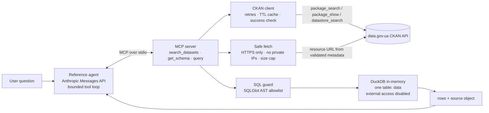

# Open Data MCP

An MCP server and a small reference agent that answer questions about **Ukrainian open data**
(CKAN portal [data.gov.ua](https://data.gov.ua)) from *retrieved data and deterministic SQL*, not
from model memory. Every successful data-backed answer carries machine-readable provenance.

> **Status: working prototype, not production software.** The CKAN adapter, SQL safety layer, MCP
> server, agent and evaluation are implemented and tested **offline against a mocked portal and
> SYNTHETIC fixtures**. A live smoke test against `data.gov.ua` passed on 2026-10-18 (one real CSV
> resource, CSV path only; see [Verification status](#verification-status) for exactly what was and
> was not exercised).

## The problem

Asking an LLM "how many … were registered in region X in 2023?" invites a confident, unsourced,
possibly invented number. Open-data portals publish the real figures, but finding the right
resource, understanding its columns and computing an aggregate is tedious. This project lets a
model do exactly that **through tools**, with a hard boundary: numbers come from a SQL query over
the real resource, and the answer shows where the data came from and when it was fetched.

## What you can ask

Questions whose answer is a computation over one tabular resource, in Ukrainian or English:

- *"Скільки звернень у Центральному районі?"* → `COUNT` with a filter
- *"Total planned budget for 2024 across regions?"* → `SUM` over a DataStore resource
- *"Which region executed the most in 2023?"* → `GROUP BY … ORDER BY`
- *"Find datasets about air quality"* → dataset search

It should **refuse or abstain** when the data cannot answer (forecasts, opinions, unsupported
formats, oversized files, columns that do not exist).

## Architecture



Source layout (`src/open_data_mcp/`): `ckan_client.py`, `safe_fetch.py`, `query_engine.py`,
`provenance.py`, `service.py` (pure-Python logic), `server.py` (MCP), `agent.py`, `cli.py`,
`fakeportal.py` (synthetic fixtures for offline use).

## Why MCP, and the three tools

MCP keeps the data layer independent from any one model or UI: the same server works with the
bundled agent, Claude Desktop/Code, or any MCP client. All tools are read-only and publish JSON
input *and* output schemas.

| Tool | Purpose |
|---|---|
| `search_datasets(query, limit)` | Dataset ID, title, short description, organization, license, URL, resource formats. `limit` is clamped to 20. |
| `get_schema(dataset_id, resource_id?)` | Columns/types and **how they were obtained**: `datastore_metadata` (authoritative) or `inferred_from_file` (a guess, flagged `authoritative: false`). Without `resource_id` it lists the dataset's resources and which are queryable. |
| `query(dataset_id, resource_id, sql, limit?)` | One read-only `SELECT` over a single resource, exposed as table `data`. Returns columns, rows, `truncated`, `row_limit`, `rows_in_resource` and `source`. |

Every tool returns an envelope with `ok`. On failure: `ok: false`, an `error` object with a stable
`code` (`unsafe_sql`, `unsafe_url`, `unsupported_resource`, `resource_too_large`, `sql_error`,
`not_found`, `upstream_error`, …) and a `hint`; **no rows, no numbers**.

## Provenance

`build_source()` is the only way a `source` object is made, and `assert_provenance()` refuses to
return a query result without `portal`, `dataset_id`, `resource_id` and `retrieved_at_utc`.

```jsonc
"source": {
  "portal": "...", "dataset_id": "...", "dataset_title": "...", "dataset_url": "...",
  "resource_id": "...", "resource_name": "...", "resource_url": "...",
  "retrieved_at_utc": "2026-10-18T20:20:04Z",   // when THIS SERVER fetched the data
  "metadata_retrieved_at_utc": "...",           // metadata may be older (TTL cache)
  "dataset_modified_at": null,                  // the portal's own date; null if not supplied
  "resource_modified_at": null, "license": null, "access_method": "file_download"
}
```

`retrieved_at_utc` is never used as a stand-in for the portal's publication/modification date;
unknown dates stay `null`. The tool also returns a one-line `citation`, and the reference agent
appends any citation the model forgot to include, so the source always reaches the user.

## How read-only SQL is constrained

1. **AST allowlist (SQLGlot, DuckDB dialect):** exactly one statement; root must be
   `SELECT`/`UNION`/`EXCEPT`/`INTERSECT` (CTEs allowed). Every table reference must be `data` or
   a CTE defined in the query: no file paths, URLs, `schema.table`, or table functions
   (`read_csv`, `glob`, `range`, …). Functions must be typed SQLGlot functions or on a small
   allowlist; `getenv`, `read_text`, `current_setting`, … are rejected. Parameters are rejected.
2. **Regenerated SQL:** the statement DuckDB runs is rendered from the validated AST, with a
   server-side `LIMIT` (default 20, hard max 100).
3. **Engine lockdown:** data is loaded into an in-memory table *first*; then
   `enable_external_access=false`, extension auto-loading off and `lock_configuration=true`.
   Tests confirm that even raw `read_csv('/etc/passwd')`, `COPY … TO`, `INSTALL` and `SET` fail
   at the DuckDB level.
4. **Resource limits:** 25 MB download cap, 500 000 row cap (refused, never silently truncated, so
   an aggregate always covers the entire resource), 20 s query timeout, 512 MB memory limit.
5. **No LLM-supplied URLs:** the model passes `dataset_id` + `resource_id`; the URL comes from
   CKAN metadata, must be `https://` on port 443, must resolve only to public addresses, and
   every redirect hop is re-validated.

Supported formats: CKAN DataStore, CSV (UTF-8 or Windows-1251, any delimiter DuckDB sniffs) and
JSON (array of flat records). XLS/XLSX, PDF, archives and other binaries are refused with
`unsupported_resource`.

## Setup

Requires Python ≥ 3.11 (developed and tested on 3.13.16; the suite also passes on 3.11.17) and
[`uv`](https://docs.astral.sh/uv/).

```bash
git clone https://github.com/AnatoliiBalakiriev/Open-Data-MCP && cd Open-Data-MCP
uv sync --locked
```

### Run the MCP server

```bash
uv run open-data-mcp serve                      # live portal (default https://data.gov.ua)
uv run open-data-mcp serve --offline-fixtures   # SYNTHETIC data, no network
```

Connect an MCP client (stdio). Example for Claude Code / Claude Desktop style config:

```json
{
  "mcpServers": {
    "open-data": {
      "command": "uv",
      "args": ["run", "--directory", "/path/to/Open-Data-MCP", "open-data-mcp", "serve"]
    }
  }
}
```

*(The stdio protocol path is covered by an automated test with the official MCP client; the
config above has not been tried in Claude Desktop itself.)*

### Ask a question through the reference agent

```bash
cp .env.example .env        # then put ANTHROPIC_API_KEY in .env
uv run open-data-mcp ask "Скільки звернень у Центральному районі?" --offline-fixtures
uv run open-data-mcp ask "Find datasets about air quality"       # live portal
```

The agent uses the Anthropic Messages API (`ANTHROPIC_MODEL`, default `claude-sonnet-5-5`, checked
against the official models overview page on 2026-10-18), connects to the server over stdio,
forwards MCP tool definitions as Anthropic tools, and runs a loop capped at 8 model calls
(`--max-iterations`). Without an API key it prints setup instructions and exits with code 2;
the server, tests and offline evaluation never need a key.

Behind an HTTP proxy that does the DNS resolving (no local DNS), the SSRF guard cannot resolve
resource hosts and refuses them. List hosts you trust explicitly:
`OPEN_DATA_TRUSTED_DOWNLOAD_HOSTS=data.gov.ua,opendata.gov.ua` (HTTPS is still required).

### Tests, lint, evaluation

```bash
uv run pytest                          # offline: mocked CKAN + synthetic fixtures
uv run ruff check . && uv run ruff format --check .
uv run mypy
uv run python evals/run_eval.py        # offline evaluation (Level 1)
uv run python scripts/smoke_live.py    # live smoke test against data.gov.ua (needs network)
```

## Evaluation results

Generated by `uv run python evals/run_eval.py --update-readme`. **Level 1 only**: it sends the
*gold SQL* through the real MCP `query` tool against a **synthetic** fixture portal and compares
with answers computed independently in plain Python. It validates the data path (SQL safety,
loading, provenance, refusals). It does **not** measure how accurately an LLM writes SQL or words
its answer; that is Level 2 (`--live`, needs an API key, costs money, **not run for this README**).

<!-- eval-results:start -->
**Level 1 - tool pipeline (offline, deterministic)** — fixture: SYNTHETIC data (not data.gov.ua).

| Metric | Passed / Total |
|---|---|
| Answer correctness (numeric/categorical) | 20 / 20 |
| Provenance present and correct | 20 / 20 |
| Correct abstention / refusal | 7 / 7 |

Skipped (agent-level only, need a live LLM): live-forecast, live-opinion.

Failed cases: 0
<!-- eval-results:end -->

Details, case list and limitations: [`evals/README.md`](evals/README.md).

## Verification status

| What | Status |
|---|---|
| Unit/integration tests, Ruff, mypy, offline evaluation | Run locally (see results above and in your own run). |
| MCP server over real stdio subprocess + official MCP client | Tested (automated, offline fixtures). |
| GitHub Actions workflow | Written; **not yet executed on GitHub**. |
| Live `data.gov.ua` smoke test (`scripts/smoke_live.py`) | **Passed on 2026-10-18 (~21:04 UTC):** `status_show` (CKAN 2.7.2), `package_search`, `package_show` ×10, then end-to-end `get_schema` + `SELECT count(*)` on one real CSV resource (96 rows; license "Creative Commons Attribution", real `dataset_modified_at` ≠ `retrieved_at_utc`), and the generated `dataset_url` (`/dataset/<name>`) returned HTTP 200. Separately, `search_datasets` and `query` (count → 61 rows on another real CSV) and an unsafe-SQL refusal were exercised through the real MCP stdio server against the live portal. |
| Not exercised live | The **DataStore** path: none of the ~25 sampled resources had `datastore_active=true`, so it is verified only against the mock. JSON resources and large files were not queried live either. Rate limits are unknown. |
| Live behaviour that shaped the code | The portal sits behind Cloudflare and returns intermittent **HTTP 522** (now retried for API calls and downloads); some resources declare their format with Cyrillic look-alike letters (`сsv`; now normalised); some "CSV" files are spreadsheet exports with title rows and parse into one junk column (flagged in `get_schema.note`). |
| Live agent run with a real Anthropic key | **Not run** (no key in the build environment). The loop is tested with a scripted model, including over a real stdio subprocess. |

## Data source, license, limits

- **Source:** the CKAN Action API of data.gov.ua (`/api/3/action/…`). Base URL is configurable
  (`OPEN_DATA_PORTAL_URL`), so other CKAN portals can be tried.
- **Licensing:** each dataset has its own license; the server returns it in `source.license`
  (or `null`). This repository's code is MIT-licensed. The bundled fixtures are **synthetic,
  invented test data**, not government data.
- **Freshness:** dataset *metadata* is cached for 300 s by default (`OPEN_DATA_CACHE_TTL_S`);
  *data* is fetched on every query, never cached. Provenance records both timestamps.
- **Rate limits:** unknown for data.gov.ua; the client retries 429/5xx, Cloudflare 52x and
  transient network errors up to 3 times with exponential backoff, honouring `Retry-After`. There is no throttling.
- **Known limitations:** messy real-world CSVs (title rows, merged cells) may load as garbage
  columns; always check `get_schema` sample rows; each query re-downloads the resource; no XLSX/Parquet; CSV type
  inference is DuckDB's best guess; very wide or huge files are refused; DNS answers are validated
  before the request but the HTTP library resolves again (a determined DNS-rebinding attacker who
  controls a resource host is not fully excluded); no authentication, so do not expose the server
  to untrusted networks; one dataset resource per query (no joins across resources).

## Security notes

Treat all portal metadata and file contents as untrusted. The LLM never supplies URLs or paths;
SQL is validated by AST, executed in an engine with external access disabled, and bounded in time,
memory, rows and bytes. Tool errors never include response bodies, and secrets are only read from
the environment (`.env` is git-ignored).

## Roadmap

1. Add one small, licensed real-data snapshot to the evaluation and verify the DataStore path on a
   portal resource that has it enabled.
2. Level 2 evaluation of the agent with a recorded run (tracked cost and failure analysis).
3. XLSX support and a cached, size-bounded download layer with freshness checks.
